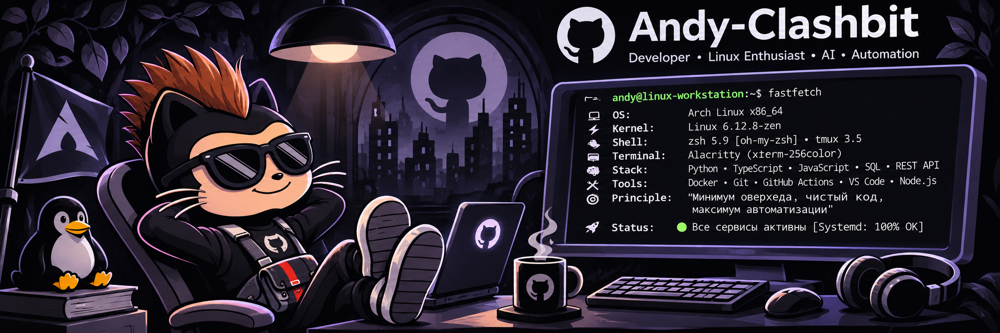
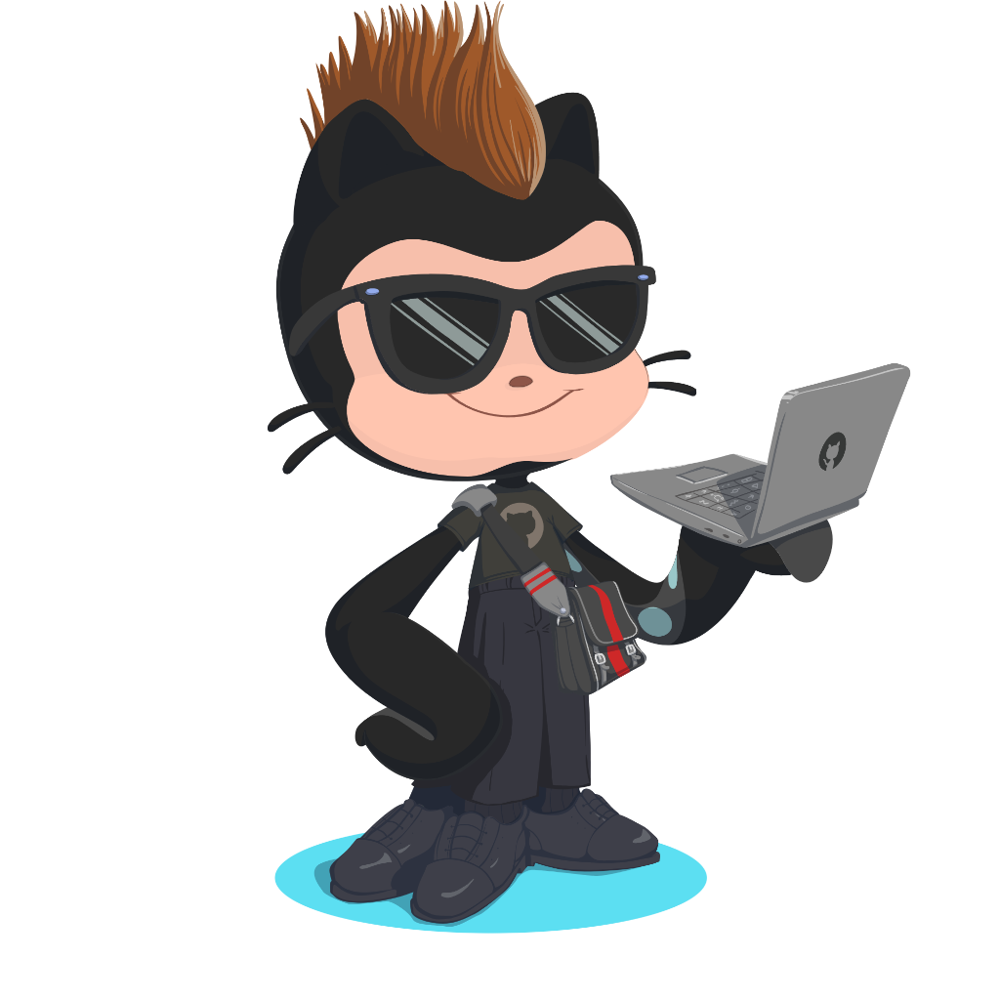
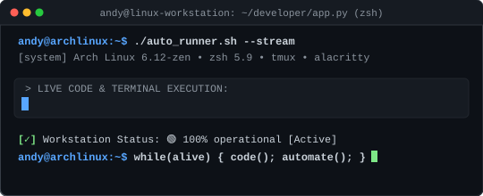

  

  

  

  <picture>
    <source media="(prefers-color-scheme: dark)" srcset="https://raw.githubusercontent.com/Andy-Clashbit/readme.md/output/bomberman-contribution-graph-dark.svg">
    <source media="(prefers-color-scheme: light)" srcset="https://raw.githubusercontent.com/Andy-Clashbit/readme.md/output/bomberman-contribution-graph.svg">
    
  </picture>

  
  
  

  

### 🛠️ // Технологический стек

  
  &nbsp;
  
  &nbsp;
  
  &nbsp;
  
  &nbsp;
  
  &nbsp;
  
  &nbsp;
  
  &nbsp;
  
  &nbsp;
  
  &nbsp;
  
  &nbsp;
  

  

  

### 🐧 // Системный терминал Linux

<table>
  <tr>
    <td width="28%" align="center" valign="middle">
      
    </td>
    <td width="72%" align="center" valign="middle">
      
    </td>
  </tr>
</table>

  

### 📊 // Статистика и аналитика GitHub

  
  

  

  

  

